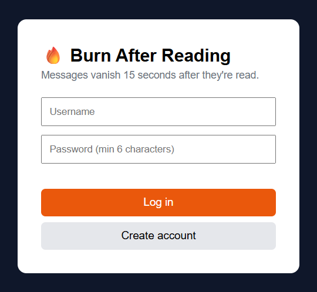
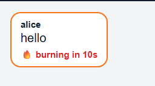
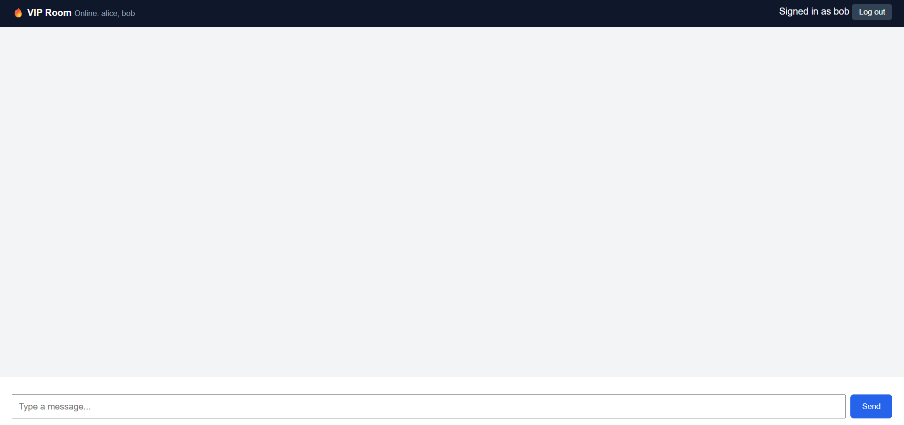

# 🔥 Burn After Reading Room

A real-time VIP chat room where messages are deleted from the database
15 seconds after the recipient reads them.

**Live demo:** https://burn-chat-p1r7.onrender.com/login.html
**Demo invite code:** `VIP2026`
**Repository:** https://github.com/shreyakushwaha39/burn-chat

> The demo runs on a free tier, so the first load after inactivity can take about 50 seconds.

## Features
- Register and login (bcrypt password hashing, JWT)
- Authenticated WebSocket connections (token verified on the handshake)
- Invite-code protected VIP room
- Live messaging with Socket.IO
- Message history stored in PostgreSQL
- Messages self-destruct 15 seconds after being read
- Sender distinction (blue "You" bubbles vs named white bubbles) and an online users list

## Tech stack
Node.js, Express, Socket.IO, PostgreSQL (Neon), vanilla HTML/JavaScript

## How "burn after reading" works
1. A message is saved with `read_at` and `burn_at` empty.
2. When a recipient's browser tab is visible, it emits `message:read`.
3. The server sets `burn_at = now() + 15 seconds`. The sender cannot trigger this.
4. A sweeper runs every second, deletes rows where `burn_at <= now()`,
   and emits `message:burned` so every screen removes the message.

`burn_at` is stored in the database, so a server restart cannot leave a message alive forever.
In a room with several users, the countdown starts when the first recipient reads the message.

## Real-time events
| Direction | Event | Payload | Purpose |
|---|---|---|---|
| Client → Server | `room:join` | `{ room, inviteCode }` | Join the room after auth |
| Server → Client | `room:history` | `[messages]` | Messages that have not burned yet |
| Server → Client | `room:denied` | text | Wrong room or invite code |
| Client → Server | `message:send` | `{ body }` | Send a message (max 500 characters) |
| Server → Room | `message:new` | `{ id, sender, body, created_at }` | Live delivery |
| Client → Server | `message:read` | `{ id }` | Start the countdown |
| Server → Room | `message:burning` | `{ id, burn_at }` | Show the countdown |
| Server → Room | `message:burned` | `{ id }` | Remove the message |
| Server → Room | `presence:update` | `[usernames]` | Who is online |
| Server → Client | `error:msg` | text | Errors and rate limit warnings |

## REST endpoints
| Method | Path | Purpose |
|---|---|---|
| POST | `/api/register` | Create an account |
| POST | `/api/login` | Returns a JWT |

## Database schema
Tables: `users`, `rooms`, `messages` (see `server/schema.sql`).

## Concurrency handling
- PostgreSQL connection pool (max 10)
- Parameterized queries only
- Every socket handler wrapped in try/catch
- Per-socket rate limit (5 messages per second) and a 500-character cap
- Load test: 20 simultaneous users x 5 messages = 100 sent,
  2000 deliveries, 0 errors (`node test/loadTest.js`)

## Run locally
```bash
cd server
npm install
# create server/.env with these three lines:
# DATABASE_URL=your-postgres-connection-string
# PORT=3000
# JWT_SECRET=any-long-random-string
node index.js
```
Open http://localhost:3000/login.html

## Project structure
```
burn-chat/
├── server/   (index.js, schema.sql, .env.example)
├── public/   (login.html, chat.html)
├── test/     (loadTest.js)
└── README.md
```

## Screenshots
| | |
|---|---|
| Login page |  |
| Two users chatting |  |
| Message burning |  |
| Empty messages table after burn |  |
| Load test result |  |
